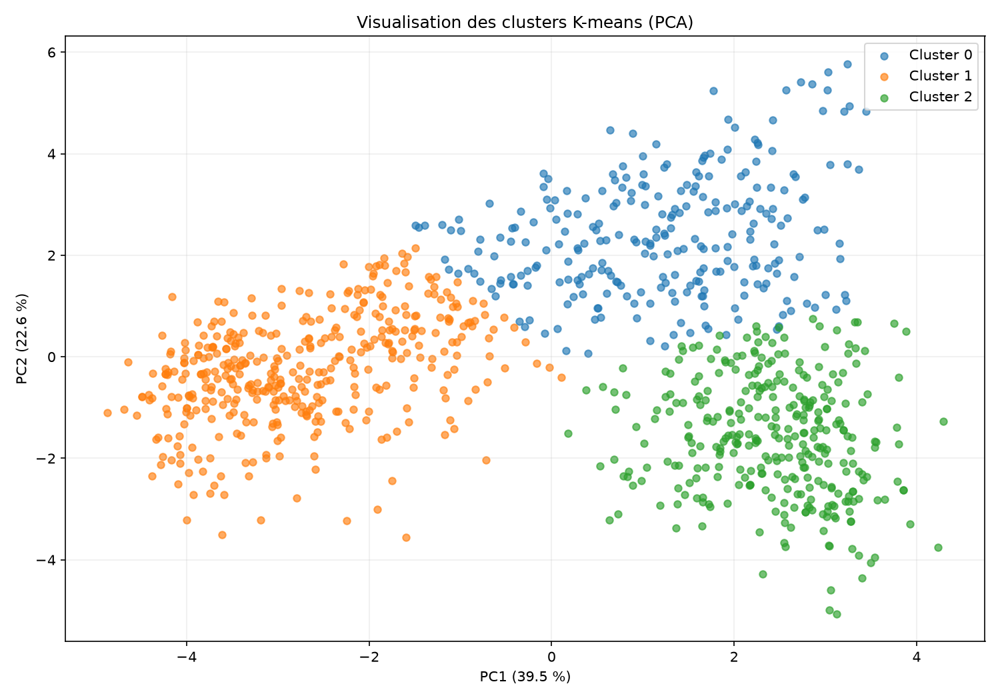
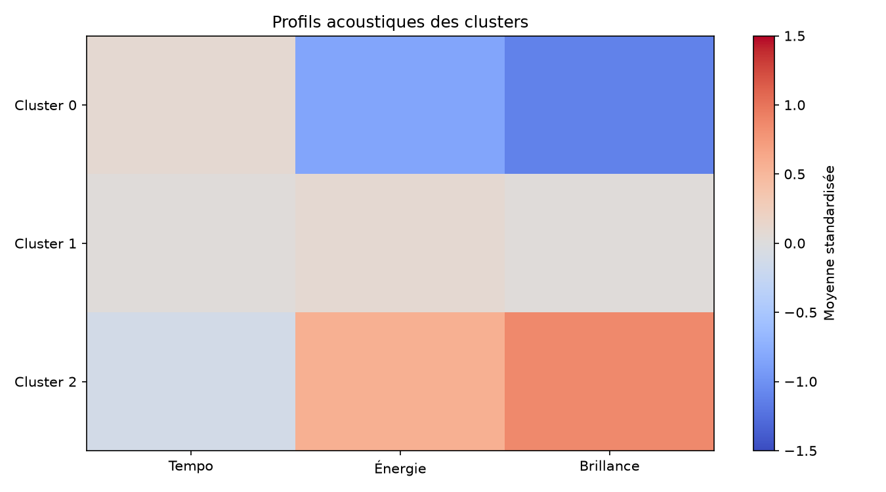
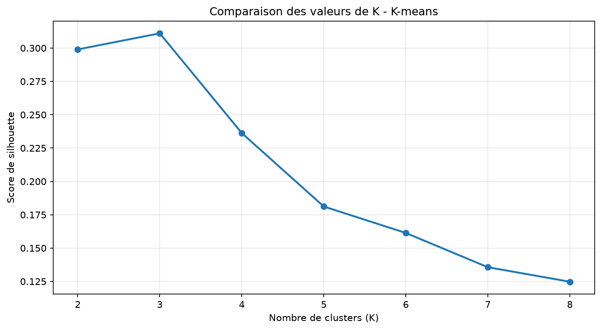
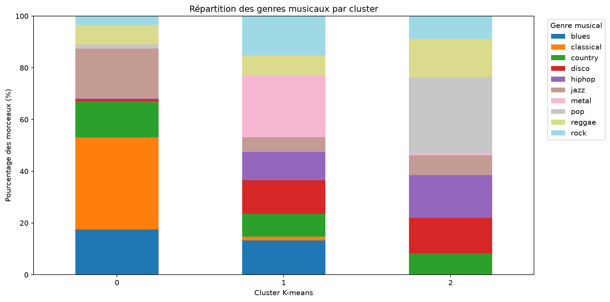

# TimbreLab — Clustering K-means et visualisation des données

## 1. Objectif

Cette partie du projet vise à analyser les caractéristiques acoustiques de morceaux musicaux et à identifier automatiquement des groupes de morceaux similaires à l'aide de l'algorithme K-means.

Contrairement à la classification supervisée, K-means ne nécessite pas de connaître les genres musicaux pendant l'entraînement.

## 2. Dataset utilisé

Les expériences ont été réalisées sur le dataset musical GTZAN, à partir d'un fichier CSV contenant 999 extraits et 10 genres musicaux.

Chaque extrait est représenté par 16 caractéristiques acoustiques, comprenant notamment le tempo, l'énergie RMS, le centroïde spectral et 13 coefficients MFCC.

Les colonnes d'identification et le genre musical ont été exclus des variables utilisées par K-means.

## 3. Prétraitement

Le prétraitement utilise un pipeline scikit-learn comprenant :

- SimpleImputer pour traiter les éventuelles valeurs manquantes.
- StandardScaler pour standardiser les caractéristiques numériques.
- KMeans pour effectuer le regroupement non supervisé.

La standardisation permet de limiter l'influence des différences d'échelle entre les variables acoustiques.

## 4. Choix du nombre de clusters

Plusieurs valeurs de K ont été évaluées, de 2 à 8, en utilisant le score de silhouette.

| K | Score de silhouette |
|---|---|
| 2 | 0,2990 |
| 3 | 0,3111 |
| 4 | 0,2362 |
| 5 | 0,1812 |
| 6 | 0,1613 |
| 7 | 0,1356 |
| 8 | 0,1248 |

La valeur K=3 a obtenu le meilleur score parmi les configurations testées. Elle a donc été retenue pour les analyses suivantes.

Le score de 0,3111 montre toutefois que les clusters ne sont pas parfaitement séparés.

## 5. Analyse des clusters

L'algorithme a réparti les 999 extraits en trois groupes :

| Cluster | Nombre d'extraits | Genre dominant |
|---|---:|---|
| 0 | 264 | Classical (35,6 %) |
| 1 | 408 | Metal (23,8 %) |
| 2 | 327 | Pop (29,4 %) |

L'analyse des caractéristiques acoustiques montre que :

- Le cluster 0 présente une énergie moyenne relativement faible et une brillance spectrale basse.
- Le cluster 1 présente des valeurs intermédiaires d'énergie et de brillance.
- Le cluster 2 présente une énergie moyenne plus importante et une brillance spectrale élevée.

Ces regroupements ne correspondent pas directement aux genres musicaux, puisqu'ils sont calculés à partir des caractéristiques acoustiques.

## 6. Visualisations

Plusieurs graphiques ont été réalisés :

- Répartition des morceaux par genre musical.
- Analyse des valeurs manquantes.
- Distribution du tempo, de l'énergie et de la brillance.
- Projection PCA en deux dimensions des clusters.
- Comparaison des profils acoustiques.
- Comparaison des scores de silhouette.
- Répartition des genres musicaux dans chaque cluster.

Les fonctions Matplotlib renvoient des figures pouvant être affichées dans Streamlit ou exportées en PNG.

## 7. Validation

Le module a été soumis à des tests automatiques vérifiant notamment le fonctionnement de K-means, la validation des paramètres, le traitement des valeurs manquantes, la reproductibilité et les fonctions de visualisation supervisée.

Les 11 tests exécutés ont réussi.

## 8. Limites

Le clustering dépend des caractéristiques sélectionnées, de leur préparation et du nombre de groupes demandé.

La projection PCA représente une simplification en deux dimensions des données acoustiques.

Les clusters ne doivent pas être interprétés comme une classification exacte des genres musicaux.

## 9. Conclusion

L'implémentation de K-means a permis d'identifier trois groupes présentant des profils acoustiques différents. Les visualisations facilitent leur exploration et leur interprétation.

Le module constitue la partie non supervisée de TimbreLab et pourra être intégré à l'interface Streamlit développée par l'équipe.

### Visualisation PCA des clusters

### Profils acoustiques des clusters

### Comparaison des valeurs de K

### Répartition des genres par cluster

